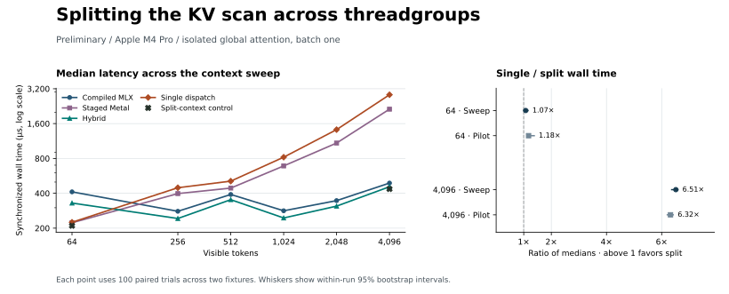

# Preliminary M4 Pro attention results

At batch one and 4,096 visible tokens, the split-context Metal schedule finished in 436 µs. Single-dispatch Metal took 2,840 µs. The earlier pilot also found a greater than sixfold wall-time difference. At 64 tokens, the sweep’s interval included a tie and the pilot favored splitting.

## Performance comparison

Each cell reports median synchronized wall time in microseconds for one decode step of the isolated global-attention path. The split control was measured at the two batch-one endpoints. A dash marks an unmeasured combination.

| Run | Batch | Visible tokens | Compiled MLX | Staged Metal | Hybrid | Single dispatch | Split-context control |
| --- | ---: | ---: | ---: | ---: | ---: | ---: | ---: |
| Sweep | 1 | 64 | 411.7 | 222.6 | 329.3 | 224.8 | 209.9 |
| Sweep | 1 | 256 | 279.7 | 397.8 | 242.4 | 446.9 | — |
| Sweep | 1 | 512 | 390.8 | 443.6 | 352.3 | 509.4 | — |
| Sweep | 1 | 1,024 | 282.6 | 689.4 | 244.9 | 820.3 | — |
| Sweep | 1 | 2,048 | 345.8 | 1,086.8 | 309.8 | 1,419.1 | — |
| Sweep | 1 | 4,096 | 490.3 | 2,131.9 | 455.7 | 2,839.9 | 436.0 |
| Sweep | 8 | 4,096 | 1,677.7 | 3,127.6 | 1,643.4 | 3,587.6 | — |
| Pilot | 1 | 64 | 302.4 | 235.0 | 253.1 | 239.0 | 203.3 |
| Pilot | 1 | 4,096 | 506.9 | 2,153.8 | 487.9 | 2,860.9 | 452.7 |

## What changes when the context is split?

Single dispatch assigns one threadgroup to each KV head. At batch one, eight threadgroups scan the entire history. The split schedule prepares the new token, scans 32-token chunks, merges their softmax statistics, then applies the gate. At 4,096 tokens its scan issues 1,024 threadgroups across eight KV heads. The staged Metal schedule also separates preparation and gating, but its scan still uses eight threadgroups. These grid dimensions describe available parallel work. A hardware trace would be needed to quantify achieved occupancy.

| Run | Tokens | Single / split wall time (95% CI) | Single GPU µs | Split GPU µs |
| --- | ---: | ---: | ---: | ---: |
| Sweep | 64 | 1.07× (0.98–1.18) | 78.5 | 51.7 |
| Pilot | 64 | 1.18× (1.16–1.40) | 130.9 | 86.0 |
| Sweep | 4,096 | 6.51× (6.34–6.61) | 2,677.7 | 277.6 |
| Pilot | 4,096 | 6.32× (6.18–6.44) | 2,691.2 | 277.6 |

The ratio divides the median single-dispatch wall time by the median split-context wall time. Intervals resample paired blocks within each fixture, with 2,000 draws per run. They quantify trial variation within each observed run. GPU columns give the native Metal command buffer’s median elapsed time. The native encoder recorded one dispatch for single, three for staged and four for split. MLX and hybrid dispatch counts require a separate trace.

## Measurement scope

Both runs used the same Apple M4 Pro, MLX 0.32.4, benchmark source and fixture seeds. Each schedule has 100 timings per cell over 2 token states. Inputs were resident before timing. The clock covers the caller’s dispatch through device completion. Schedule order was randomized within each paired block. Every reported case passed the CPU comparison and the post-timing check, and its CSV digest and pairings were verified.

The sweep uses seven certified attention cases from the first full-study attempt. The pilot independently collected the two batch-one endpoints. The table keeps their medians separate. Decoder-stack performance and the two-session publication report require complete compatible runs.

Run `.venv/bin/python -m analysis.preliminary` from the project root with the original [sweep](../results/m4pro-01-a/full/) and [pilot](../results/m4pro-01-pilot/pilot/) case files present. See the [benchmark protocol](../bench/README.md) and [Inkling-inspired architecture](../docs/architecture.md).
