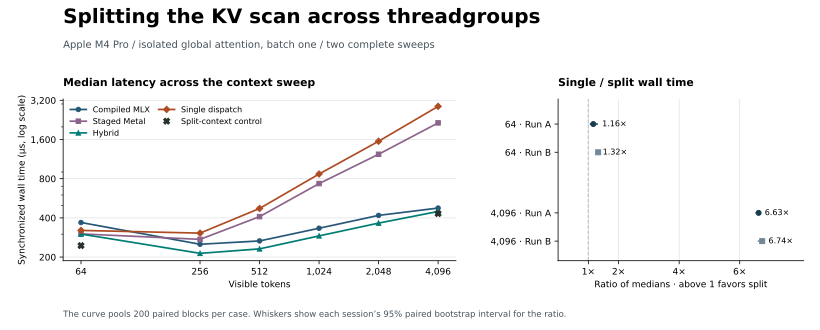

# Attention on the M4 Pro

## Median latency by schedule

Each cell gives synchronized wall time in microseconds for one cached global-attention step, pooled across two complete sessions. Each session contributes 100 paired blocks per case across two seeded states. The split control ran at the two batch-one endpoints.

| Batch | Visible tokens | Compiled MLX | Staged Metal | Hybrid | Single dispatch | Split-context control |
| ---: | ---: | ---: | ---: | ---: | ---: | ---: |
| 1 | 64 | 368.5 | 301.3 | 300.5 | 320.5 | 245.0 |
| 1 | 256 | 250.9 | 273.6 | 213.6 | 305.6 | — |
| 1 | 512 | 266.1 | 409.1 | 231.3 | 472.6 | — |
| 1 | 1,024 | 333.1 | 733.5 | 291.0 | 869.1 | — |
| 1 | 2,048 | 418.1 | 1,232.6 | 364.8 | 1,551.3 | — |
| 1 | 4,096 | 476.0 | 2,146.3 | 448.5 | 2,875.3 | 431.7 |
| 8 | 4,096 | 1,683.6 | 3,126.1 | 1,618.7 | 3,583.0 | — |

## How well did the split effect repeat?

| Tokens | Run | Single µs | Split µs | Single / split (95% CI) | Single GPU µs | Split GPU µs |
| ---: | --- | ---: | ---: | ---: | ---: | ---: |
| 64 | Run A | 307.7 | 264.6 | 1.16× (1.05–1.32) | 131.4 | 87.1 |
| 64 | Run B | 321.0 | 242.6 | 1.32× (1.31–1.33) | 230.2 | 150.8 |
| 64 | Pooled | 320.5 | 245.0 | 1.31× (1.29–1.33) | — | — |
| 4,096 | Run A | 2,877.5 | 434.3 | 6.63× (6.53–6.69) | 2,714.5 | 278.2 |
| 4,096 | Run B | 2,870.6 | 425.8 | 6.74× (6.59–6.81) | 2,716.1 | 278.6 |
| 4,096 | Pooled | 2,875.3 | 431.7 | 6.66× (6.59–6.73) | — | — |

Each ratio divides the median single-dispatch time by the median split-context time. The 95% intervals use 2,000 bootstrap draws, resampling whole paired blocks within each session and fixture. They describe trial variability on the recorded Mac in these two consecutive processes. Run A and Run B had different randomized schedule orders. Both started on AC power with the reported thermal state nominal.

At 4,096 tokens, single dispatch gives eight threadgroups the entire cache scan. Splitting it into 32-token chunks issues 1,024 scan threadgroups followed by a merge. The native encoder records one dispatch for single, three for staged and four for split. The GPU columns come from Metal command-buffer timestamps. Achieved occupancy and the internal MLX dispatch counts require a trace.

At 64 tokens, the fastest of the four main schedules changed from staged in A to hybrid in B. The separate split control had the lowest median at both tested endpoints in both sessions. Among the four main schedules, hybrid had the lowest median in both sessions at every measured length from 256 onward and at batch eight. The batch-eight row measures latency for eight simultaneous sequences.

## Reproduce

Run `.venv/bin/python -m analysis.verified` from the repository root. The generator checks the CSV digests, pre- and post-timing certificates, pairing, hardware, source revision and seeded fixtures. Each figure embeds its source and per-case CSV hashes. The single, staged, split and MLX timings all charge CPU dispatch and GPU completion. The prepared inputs are device resident when timing starts. Whole-decoder timings have a separate correctness gate.

Benchmark source SHA-256 `f807d8a4329016e1d365e31fefd3a44796f7442ccb80d4b1f50d227acc706237`. [Run A](../results/m4pro-02-a/attention/) · [Run B](../results/m4pro-02-b/attention/) · [Registered measurement protocol](../bench/README.md)
