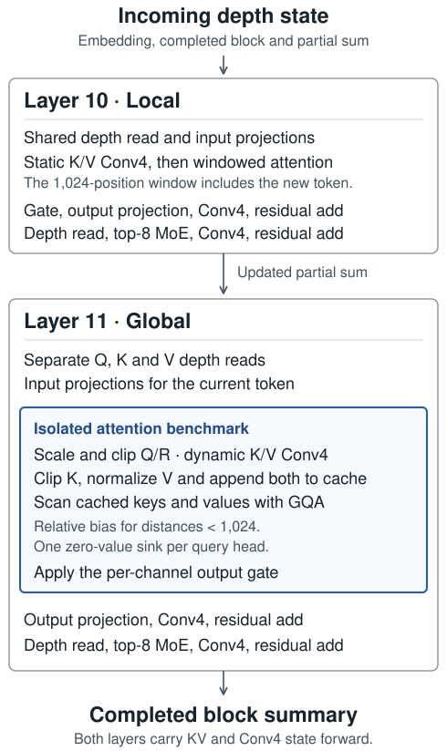

# The Inkling-inspired decoder

A new token writes one key and one value into each KV head’s cache. Its six query heads immediately read that entry, along with the earlier entries, to produce their outputs. The experiment moves the boundary between those operations. A single-dispatch kernel can keep the current token’s prepared data local, while a separate scan can divide a long history among more GPU threadgroups. Both schedules must produce the same gated output and leave the same cache for the next token.

## Where the inputs come from

The decoder experiment connects layers 10 and 11 in zero-based indexing. Layer 10 reads a 1,024-token local window. Layer 11 attends over the entire available history. Both belong to the same six-layer residual block. Each token enters the slice with an embedding vector, a completed summary of layers 0–5 and the running sum of layers 6–9. We seed those incoming states. Layer 10 updates the running sum used by layer 11. The output of layer 11 completes the summary for layers 6–11. [Checkpoint config](https://huggingface.co/thinkingmachines/Inkling-2-Small/blob/1df2d97d45210d94f781f42a6521392e5a539e46/config.json) · [Decoder and block-attention implementation](https://github.com/huggingface/transformers/blob/109a7d19bf667168837f32929e00b791e195d14d/src/transformers/models/inkling2/modeling_inkling2.py#L733)

The isolated benchmark takes the global path outlined in blue at full head geometry. The two-layer benchmark includes both boxes at reduced width. Each layer first updates the partial residual sum with its projected, convolved attention output. A second depth read feeds its routed MoE, whose convolved output updates that sum again.

**Depth and time are different axes.** A depth read stays at the current token position. It RMS-normalizes each candidate block vector, scores them using a learned query with scale $1/\sqrt{d_{model}}$, and returns their softmax-weighted mixture. The same normalized candidates serve as keys and values. A learned RMSNorm prepares the mixture for the subsequent projection. By contrast, the K/V cache and the four convolution histories persist across successive tokens. [Depth read and pre-norms](https://github.com/huggingface/transformers/blob/109a7d19bf667168837f32929e00b791e195d14d/src/transformers/models/inkling2/modeling_inkling2.py#L733)

## Inside the timed attention path

1. **Prepare Q and the relative features.** Apply learned per-head, per-channel scales to Q and the 16-component relative feature vector R, then clip their vector lengths to $22.6274\ldots$ and $8$ respectively. K uses the same threshold as Q after convolution. Its clip has no learned scale. The global layer multiplies clipped Q and R by a position-dependent temperature factor. This factor equals one for every length in the benchmark sweep, all of which are at or below 4,096. The pinned checkpoint sets the logarithmic scaling floor at 8,192. [Clip implementation](https://github.com/huggingface/transformers/blob/109a7d19bf667168837f32929e00b791e195d14d/src/transformers/models/inkling2/modeling_inkling2.py#L137) · [Updated checkpoint setting](https://huggingface.co/thinkingmachines/Inkling-2-Small/commit/1df2d97d45210d94f781f42a6521392e5a539e46)
2. **Prepare K and V.** Each convolution combines the current raw projection with up to three preceding raw projections. In lag order, the static operation is $(x_t+\sum_{j=0}^3 w_j x_{t-j})/\sqrt{5}$. The dynamic operation replaces $w_j$ by $w_j+a_{t,j}$ and uses divisor $3$. Its four predicted tap adjustments are shared across channels of one KV head. V then receives per-head RMS normalization without a learned scale. The experiment stores K/V in FP16 and uses those rounded values for the current step as well as future steps. [Static and dynamic convolutions](https://github.com/huggingface/transformers/blob/109a7d19bf667168837f32929e00b791e195d14d/src/transformers/models/inkling2/modeling_inkling2.py#L249)
3. **Scan the KV cache.** For query head $h$, position $t$, and earlier position $i$, the content score is $q_{t,h}^\top k_{i,g(h)}/\sqrt{d_{head}}$. Add $r_{t,h}^\top P_{:,t-i}$ when $0\leq t-i<1024$, using the learned distance-profile matrix shared by the heads. At distance 1,024 the relative term becomes zero. An old key still participates in global attention. The local layer drops it from its window. [Relative logits](https://github.com/huggingface/transformers/blob/109a7d19bf667168837f32929e00b791e195d14d/src/transformers/models/inkling2/modeling_inkling2.py#L166)
4. **Apply the sink and gate.** Each head predicts one scalar sink logit for the token. It enters the softmax denominator exactly once and contributes zero to the value sum. The output gate has one sigmoid per channel of each query head. Gating ends the isolated attention measurement. The decoder measurement additionally charges the input and output projections, attention-output convolution, routed experts, MoE-output convolution and depth reads. [Gated attention](https://github.com/huggingface/transformers/blob/109a7d19bf667168837f32929e00b791e195d14d/src/transformers/models/inkling2/modeling_inkling2.py#L501)

For the expert branch, the router selects the eight largest sigmoid scores after adding the selection bias. It uses the corresponding *unbiased* sigmoid scores to weight those experts, normalizing their sum to eight. Inside each expert, the sigmoid sees the raw gate $g$. The elementwise activation is $4\tanh(g/4)\,\sigma(g)\,25\tanh(u/25)$ for gate and up projections $g,u$. The gated activation is projected back to residual width before merging the selected expert outputs. [Experts and router](https://github.com/huggingface/transformers/blob/109a7d19bf667168837f32929e00b791e195d14d/src/transformers/models/inkling2/modeling_inkling2.py#L642)

## What the timings represent

| Quantity | Released text decoder | Two-layer benchmark | Isolated global attention |
| --- | ---: | ---: | ---: |
| Decoder layers | 48 | 2 | One post-projection path |
| Residual width | 4,608 | 1,152 | Outside timed input |
| Query heads / KV heads | 48 / 8 | 12 / 2 | 48 / 8 |
| Head dimension | 128 | 128 | 128 |
| Expert count / active experts | 384 / 8 | 384 / 8 | Outside timed boundary |
| Intermediate width per expert | 2,304 | 576 | Outside timed boundary |

The FP16 expert matrices for the two reduced-width layers require $2\times384\times3\times1152\times576\times2=3{,}057{,}647{,}616$ bytes, about 2.85 GiB. A single 48:8 global attention layer needs 16 MiB of FP16 KV cache for a 4,096-position sequence at batch one. These are tensor sizes. Peak process memory also includes other weights, temporaries and framework allocations.

The benchmark uses seeded weights and states. The two-layer timings characterize the FP32-expert precision control for this Inkling-inspired decoder on the M4 Pro. The production model uses trained weights and mixed-precision experts and has additional work from the remaining layers and the vocabulary head. Published production optimizations already include several Inkling kernel fusions on NVIDIA hardware. [Model card](https://huggingface.co/thinkingmachines/Inkling-2-Small) · [Thinking Machines and Inferact’s implementation](https://vllm-project.github.io/2026/11/12/inkling2-small.html)
