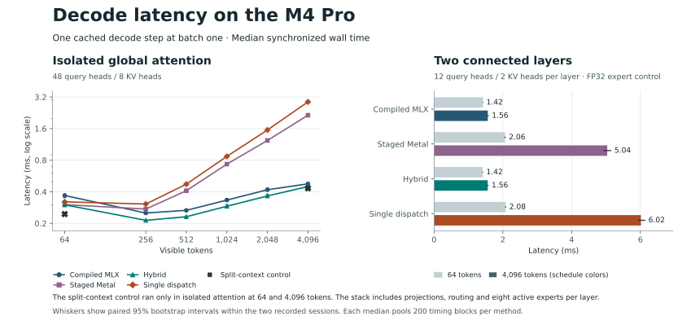

# Studying Megakernels on a Mac

A GPU can have plenty of arithmetic capacity and still wait for work. Between one kernel and the next, an intermediate may need to be written to memory, a dependent dispatch must become runnable, and different parts of the GPU may finish at different times. A megakernel moves some of that scheduling inside a single dispatch. The operating-system analogy helps explain the motivation. While one group of workers waits for data, another can advance an independent part of the computation.

Flapping Airplanes describes an instruction-driven Kittens Virtual Machine that can schedule training, inference and a game inside a persistent kernel. LMSYS chose a narrower boundary for Muse Spark Open. Its megakernel spans one layer's attention through the next layer's QKV projection and KV write. LMSYS reports 1,109 versus 517 tokens/s for a batch-one comparison on eight GB300s. Those are serving-system results with speculative decoding. On my MacBook, I wanted to isolate a scheduling decision I could actually measure. [Flapping Airplanes](https://x.com/flappyairplanes/status/2112955825367269788) · [LMSYS](https://www.lmsys.org/blog/2026-11-05-muse-spark-open-ultrafast)

## One token writes what it is about to read

When a decoder advances by one token, it prepares new keys and values, writes them to the cache and immediately attends over the cache, including that new entry. Should the writer also perform the scan? Combining them saves a dispatch boundary and lets the six query heads that share a KV head consume the current entry directly from threadgroup memory. Keeping the scan separate lets a specialized attention kernel distribute long histories across more workers.

The experiment uses two adjacent layer types from Inkling 2 Small. Both use grouped-query attention, four-tap causal convolutions, clipped queries and keys, normalized values, learned relative scores, a zero-value attention sink and a per-channel output gate. The local layer reads the last 1,024 positions. The global layer has separate Q/K/V depth reads and token-dependent K/V convolution taps. Both layers execute their eight selected experts. The [model diagram and numerical specification](architecture.md) give the block-state inputs, projection boundaries and exact operations.

## Four implementations of the same operation

The standalone kernel uses the published head geometry, 48 query heads sharing eight KV heads with 128 channels per head. At batch one, a 4,096-entry FP16 K/V cache occupies 16 MiB. The single-dispatch version maps one threadgroup to each KV head. It forwards the freshly rounded current entry on-chip while streaming older entries in tiles. This exposes eight independent threadgroups. At long contexts, extra parallelism may be worth a second dispatch to combine partial softmax results.

The staged Metal implementation gives the same scan its own dispatch. The compiled MLX baseline uses its optimized attention primitive. The hybrid uses custom Metal for preparation and MLX for cache append, attention and gating. A fifth diagnostic schedule partitions the history and merges partial softmax statistics. All methods start from the same projected inputs and end with the same observable gated heads and persistent state.

## What has been verified

The CPU reference processed a 64-token trajectory at the published head dimensions. An independent prefix implementation, with FP64 arithmetic at the agreed FP16 storage boundaries, gave a maximum absolute gated-output difference of 0.0009765625. In the connected two-layer test, the width is 1,152 and each layer contains 384 experts, eight active per token. The full expert matrices occupy 2.85 GiB. CPU passes at visible lengths 64 and 4,096 returned finite summaries and cache states. The weights and incoming upstream block states are seeded.

## One dispatch or four?

On my M4 Pro, the single-dispatch implementation took 2,875 µs to process one token against 4,096 visible positions. Dividing the history into 32-token chunks and merging their softmax statistics took 432 µs across four dispatches. That is a **6.66× speedup over the single-dispatch Metal implementation**. The two independent sweeps measured 6.63× and 6.74×. Optimized MLX already took just 476 µs, so the same split kernel was **1.10× as fast as compiled MLX**.

| Isolated global attention, median wall time | Compiled MLX | Staged Metal | Hybrid | Single dispatch | Split context |
| --- | ---: | ---: | ---: | ---: | ---: |
| Batch 1, 64 tokens | 368.5 µs | 301.3 µs | 300.5 µs | 320.5 µs | 245.0 µs |
| Batch 1, 4,096 tokens | 476.0 µs | 2,146.3 µs | 448.5 µs | 2,875.3 µs | 431.7 µs |
| Batch 8, 4,096 tokens | 1,683.6 µs | 3,126.1 µs | 1,618.7 µs | 3,583.0 µs | — |

At batch one, the staged implementation already separates preparation, scan and gate. Its scan still assigns the entire history of each KV head to one threadgroup. The split implementation divides that scan among 1,024 threadgroups at 4,096 tokens, up from eight. On the GPU itself, single dispatch took about 2,715 µs and split took about 278 µs in each sweep. The difference therefore extends well beyond CPU launch time. The eight and 1,024 threadgroups are calculated from the launch geometry. The launch grid and device time establish how much parallel work was available and how long the GPU spent executing it. Measuring the fraction of the GPU that stayed occupied requires its own evidence.

At 64 tokens, the single-to-split ratio shrank to 1.31×. The fastest of the four main schedules also switched from staged to hybrid between sweeps. From 256 through 4,096 tokens, hybrid had the lowest median of those four schedules in both runs. Each cell pools 200 synchronized, paired timing blocks across two seeded token states. The pooled 95% interval for the single-to-split ratio was 1.29–1.33× at 64 tokens and 6.59–6.73× at 4,096. These intervals describe trial variation within the two consecutive sessions on this Mac. [All seven measured workloads, per-session results and raw trials](../analysis/attention-verified.md)

I also marked one warmed decode in Instruments for single, split, compiled MLX and hybrid. Each mark contained one command buffer, one compute encoder and one active GPU interval. The native split path submitted four dispatches inside its encoder. Instruments grouped them into one interval, so this capture cannot tell us how many dispatches MLX submitted or what occupancy the GPU achieved. The timings above come from the unprofiled sweeps. [Trace observations](../analysis/trace-observations.json)

## How far does the result carry into the decoder?

In the two-layer decoder, the most competitive schedules were compiled MLX and hybrid. At 4,096 visible tokens, they both took **1.56 ms**. The single-dispatch attention implementation took **6.02 ms** within the same decoder. At 64 tokens, its gap to compiled MLX was smaller, 2.08 versus 1.42 ms.

| One decode step, batch one | Compiled MLX | Staged Metal | Hybrid | Single dispatch |
| --- | ---: | ---: | ---: | ---: |
| Two layers, 64 visible tokens | 1.423 ms | 2.064 ms | 1.417 ms | 2.081 ms |
| Two layers, 4,096 visible tokens | 1.562 ms | 5.036 ms | 1.560 ms | 6.017 ms |

These measurements include two layers' projections, attention, convolutions, routing and expert execution. Both layers use 12 query heads and two KV heads. At 4,096 visible tokens, the local layer sees the most recent 1,024 and the global layer sees all 4,096. The staged and single schedules include the cost of synchronizing MLX with their native Metal attention calls. The split-context control was measured only in the 48-query-head isolated attention experiment.

I used a separate precision control for the stack. In the original FP16 workload, all four schedules agreed with the CPU on the final residual and both layers’ expert IDs. One seed still crossed the tolerance in the second layer’s expert-output history. At one affected channel, eight signed contributions with absolute values totaling 3.887 summed to just +0.01356. Swapping the GPU residual from layer 10 into an otherwise CPU calculation reproduced discrepancies. Swapping only the gated attention output passed all four fixtures. [Crossover and numerical diagnostics](../analysis/crossover-results.md)

For the timed control I kept the expert weights in FP16 and used the same FP32 expert calculation in all four schedules. This holds the expert input, projection outputs, activation and weighted sum in FP32 until the sum is stored in FP16. Each schedule passed the same 15 output and state checks against the control’s CPU reference before and after timing. The two sessions contributed 1,600 synchronized timings across two lengths, two seeded states and four schedules. [Timing table, confidence intervals and raw trials](../results/precision-control-01/report.md)

The compiled-to-hybrid latency ratio was 1.004× at 64 tokens and 1.001× at 4,096. The paired 95% intervals were 0.993–1.010× and 0.987–1.016×. At 4,096 the faster schedule switched between sessions. On this Mac, the clearest win came from dividing a long cache scan among more threadgroups. Once the attention scan already used MLX’s optimized primitive, custom preparation produced little measurable change in this two-layer workload.

The release includes the raw trials for all 38 measured workload–schedule combinations. You can rebuild the tables and figure on CPU or repeat the experiment on another Metal-visible Mac. [Reproduce the study](../REPRODUCIBILITY.md)
