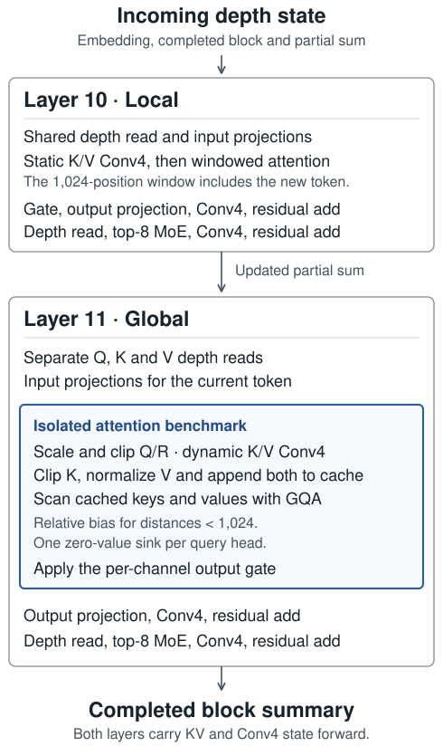
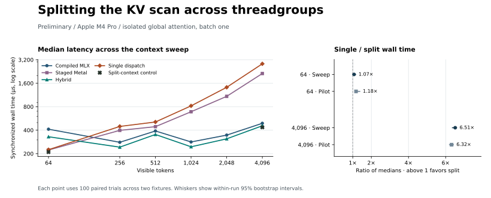

# Megakernels on a Mac

A GPU can have plenty of arithmetic capacity and still wait for work. Between one kernel and the next, an intermediate may need to be written to memory, a dependent dispatch must become runnable, and different parts of the GPU may finish at different times. A megakernel moves some of that scheduling inside a single dispatch. The operating-system analogy helps explain the motivation. While one group of workers waits for data, another can advance an independent part of the computation.

Flapping Airplanes describes an instruction-driven Kittens Virtual Machine that can schedule training, inference and a game inside a persistent kernel. LMSYS chose a narrower boundary for Muse Spark Open. Its megakernel spans one layer's attention through the next layer's QKV projection and KV write. LMSYS reports 1,109 versus 517 tokens/s for a batch-one comparison on eight GB300s. Those are serving-system results with speculative decoding. On my MacBook, I wanted to isolate a scheduling decision I could actually measure. [Flapping Airplanes](https://x.com/flappyairplanes/status/2112955825367269788) · [LMSYS](https://www.lmsys.org/blog/2026-11-05-muse-spark-open-ultrafast)

## One token writes what it is about to read

When a decoder advances by one token, it prepares new keys and values, writes them to the cache and immediately attends over the cache, including that new entry. Should the writer also perform the scan? Combining them saves a dispatch boundary and lets the six query heads that share a KV head consume the current entry directly from threadgroup memory. Keeping the scan separate lets a specialized attention kernel distribute long histories across more workers.

The experiment uses two adjacent layer types from Inkling 2 Small. Both use grouped-query attention, four-tap causal convolutions, clipped queries and keys, normalized values, learned relative scores, a zero-value attention sink and a per-channel output gate. The local layer reads the last 1,024 positions. The global layer has separate Q/K/V depth reads and token-dependent K/V convolution taps. Both layers execute their eight selected experts. The [model diagram and numerical specification](architecture.md) give the block-state inputs, projection boundaries and exact operations.

## Four implementations of the same operation

The standalone kernel uses the published head geometry, 48 query heads sharing eight KV heads with 128 channels per head. At batch one, a 4,096-entry FP16 K/V cache occupies 16 MiB. The single-dispatch version maps one threadgroup to each KV head. It forwards the freshly rounded current entry on-chip while streaming older entries in tiles. This exposes eight independent threadgroups. At long contexts, extra parallelism may be worth a second dispatch to combine partial softmax results.

The staged Metal implementation gives the same scan its own dispatch. The compiled MLX baseline uses its optimized attention primitive. The hybrid uses custom Metal for preparation and MLX for cache append, attention and gating. A fifth diagnostic schedule partitions the history and merges partial softmax statistics. All methods start from the same projected inputs and end with the same observable gated heads and persistent state.

## What has been verified

The CPU reference processed a 64-token trajectory at the published head dimensions. An independent prefix implementation, with FP64 arithmetic at the agreed FP16 storage boundaries, gave a maximum absolute gated-output difference of 0.0009765625. In the connected two-layer test, the width is 1,152 and each layer contains 384 experts, eight active per token. The full expert matrices occupy 2.85 GiB. CPU passes at visible lengths 64 and 4,096 returned finite summaries and cache states. The weights and incoming upstream block states are seeded.

## One dispatch or four?

On my M4 Pro, a single dispatch took 2,840 µs to process one token against 4,096 visible positions. Splitting the history into 32-token chunks and merging their softmax statistics took 436 µs across four dispatches, a 6.51× difference. The pilot independently measured 2,861 versus 453 µs (6.32×). Simply separating preparation, scan and gate into three dispatches took 2,132 µs. How the scan divides work matters here even among schedules with similar dispatch counts.

| Isolated global attention, median wall time | Compiled MLX | Staged Metal | Hybrid | Single dispatch | Split context |
| --- | ---: | ---: | ---: | ---: | ---: |
| Batch 1, 64 tokens | 412 µs | 223 µs | 329 µs | 225 µs | 210 µs |
| Batch 1, 4,096 tokens | 490 µs | 2,132 µs | 456 µs | 2,840 µs | 436 µs |
| Batch 8, 4,096 tokens | 1,678 µs | 3,128 µs | 1,643 µs | 3,588 µs | — |

Each cell summarizes 100 synchronized, paired trials across two input states in the first sweep. At 64 tokens, the split control’s advantage over single dispatch was small enough that the sweep’s 95% interval included a tie. At 4,096, the split scan exposed 1,024 independent threadgroups where the single dispatch exposed eight. The native command-buffer times also fell from 2,678 to 278 µs, so host launch overhead alone cannot explain the long-context result. Measuring how busy the GPU cores were requires a hardware trace. [Trial intervals, pilot medians and raw measurements](../analysis/attention-preliminary.md)

The two-layer run stopped at its first correctness check. Four of 3,456 entries in the global layer’s expert-output history exceeded the registered tolerance at 64 tokens. A CPU control showed that changing just the projection accumulation can also push this intermediate past tolerance while both expert routes and the final residual pass. The cause of the four GPU differences is still open. End-to-end latencies will depend on the time spent in projections, routing and experts as well as the attention scan. [CPU sensitivity experiment](../decoder/README.md)
